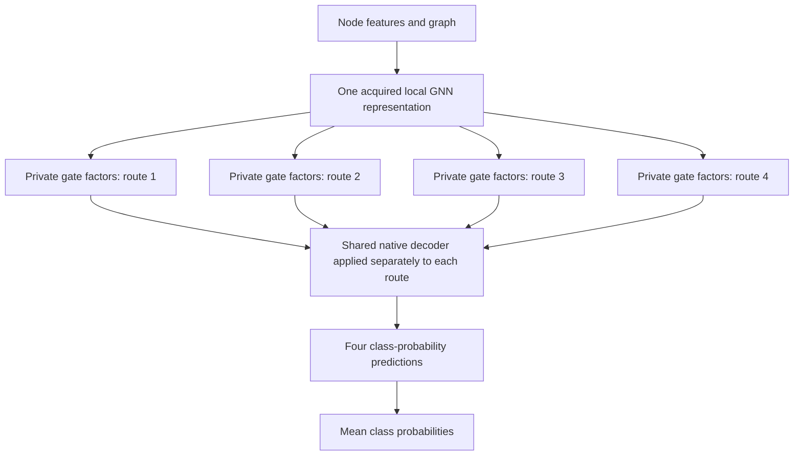

# GNNM: shared propagation in graph ensembles

## Shared-backbone ensemble research — 15 October 2026

The aim is better predictions from several learned routes through one shared
native GNN. Every compatible setting compares the native single model, original
GNNM and four genuinely independent native models. Separate reference-setting
runs check the source papers. Native operators, features, LR and WD are fixed.
Source ambiguities and longer training controllers are disclosed.

### Completed molecular pilots

The MolBACE/GIN study completed 24 fits across three paired seeds. Each seed
trained four independent native models and four shared methods. Every fit used
the complete TRAIN and VALID sets, its own first-best AUC checkpoint, and the
frozen minimum 100 / cap 1,000 / patience 50 controller. Training lasted 149–210
epochs per fit, totaling 3,680 epochs and 139,840 updates. Elapsed time was
7.81 hours while another existing job shared the dedicated GPU.

| Method | Mean VALID AUC ± SD (%) | Mean BCE |
| --- | ---: | ---: |
| Native single | 73.32 ± 1.17 | 0.779 |
| Independent ensemble | 74.85 ± 0.50 | 0.890 |
| Base GNNM | 67.78 ± 4.39 | 0.719 |
| Alignment + variance | 71.17 ± 2.66 | 0.551 |
| Private input correction | 71.76 ± 3.91 | 0.941 |
| Both ingredients | 69.28 ± 1.80 | 0.882 |
| Private BN running state | 73.61 ± 1.06 | 1.086 |
| Private BN + geometry | 73.65 ± 1.64 | 1.122 |
| Private BN + correction | 72.19 ± 1.41 | 0.816 |
| Private BN + both | 73.03 ± 1.61 | 1.030 |

Private input corrections improved base GNNM in all three seeds, but remained
below I4 on average. Combining corrections with geometry underperformed each
ingredient's mean AUC. The separate three-fit BN follow-up improved AUC over
base GNNM in all seeds, by 5.84 points on average, but remained 1.23 points
below I4 and increased BCE. It used 464 epochs and 17,632 updates. No fit in
either pilot stopped at its cap. Private BN state is a known normalization
control, not a methodological novelty claim.

Analysis of all 24 parent prediction banks found that the combined method made
fewer ranking mistakes shared by every route, yet its individual routes were
weaker. Mean member AUC was 73.41% for I4, 62.01% for base GNNM, 64.24% with
geometry, 66.07% with corrections, and 61.00% with both. The next design decisions
must consider individual prediction quality as well as diversity.

Reconstructing all three private-BN checkpoints gave mean member AUC 72.63%,
followed by a 0.99-point gain from averaging. The member-quality gap to I4 was
smaller in each seed. The separate nine-fit study has now completed all three ingredients under
private BN, reusing the 15 factorial controls. It used 1,373 full epochs and
52,174 optimizer updates, totaling 4.27 summed worker-hours. All fits stopped
by patience after 149–178 epochs. Nine selected-state collections and the
complete 30-bank analysis also finished, without TEST access.

With matched private normalization, geometry changes mean AUC by only +0.04
points, while correction reduces it by 1.43 points in all three seeds. Their
combination is 0.59 points below private BN alone. The interaction becomes
positive, but this does not imply a better predictor. Geometry's increased
averaging benefit offsets weaker members; I4 retains higher mean member AUC
and higher pooled AUC. These fixed recipes establish no improvement over I4.

[Complete factorial results, costs and interpretation](experiments_iclr/postsubmission_20260930/benchmark_expansion_20261015_v1/pilot_20261015_bn_geometry_correction_v1/complete_results_v1/INTERPRETATION.md).
The proposed 6,460-fit campaign count is unchanged.

A completed saved-prediction check compared logit and probability averaging
for every completed method across all three seeds. Probability averaging raised
base GNNM AUC to 69.01%, while I4 reached 74.90%; it did not close the gap.
No model was trained or evaluated again. All seven-bank comparisons and losses
are retained in the [aggregation report](experiments_iclr/postsubmission_20260930/benchmark_expansion_20261015_v1/analysis/complete_fixed_aggregation_v1/REPORT.md).

A completed convergence audit replayed the original selector for all 36 fits
and 5,517 full epochs. None hit its 1,000-epoch cap. All met validation patience,
while their TRAIN update losses continued decreasing. Final 50 mean VALID AUC
rose in 16/36 fits relative to the preceding 50, while mean VALID BCE worsened
in all 36. No new best AUC in the final 50 is expected from patience and is not
independent proof of convergence. These are validation early-stopping outcomes;
the evidence does not establish optimization stationarity or a blanket need for
more epochs. No training was repeated for this metadata-only audit.

[Complete convergence interpretation](experiments_iclr/postsubmission_20260930/benchmark_expansion_20261015_v1/analysis/completed_molbace_convergence_v1/FINAL_INTERPRETATION.md).

These are selected validation results on one scaffold split. Three seeds do
not establish a confirmed advantage or transfer. Test scores remain closed.
Every outcome, per-seed difference, training cost and failed combination is
retained. Different selected epochs also limit causal interpretation.

### Stronger fixed-weight normalization control

At the same three selected private-BN checkpoints, own route statistics give
mean VALID AUC 73.61%. A common-mixture control gives 68.45%, compared with
59.06% for the earlier arithmetic tie. The mixture adds variation between route
means to the average within-route variance. That correction narrows the
own-minus-common gap from 14.55 to **5.16 points**, with own banks still ahead
in all three seeds. Probability losses are mixed: the common mixture improves
BCE and Brier over own banks in one seed and worsens them in two.

The stronger control required 120 CPU VALID forwards, zero training and 25.76
seconds. Earlier tied/cyclic outcomes are retained. Saved EMA moments provide
a plug-in approximation, not exact recalibration or reconstruction of original
GNNM's sequential shared BN. These results support a matched normalization
control; they establish neither novelty nor independent-ensemble superiority.

[Complete comparison and limitations](experiments_iclr/postsubmission_20260930/benchmark_expansion_20261015_v1/analysis/bn_mixture_moments_completed_v1/INTERPRETATION.md).

### What the implementation and theory checks add

The inspected BatchEnsemble author implementation normalizes concatenated
route batches; our current molecular model normalizes routes sequentially.
The two rules have different TRAIN statistics and running-state updates. With
matched batches, weights, RNG and route order, changing only the ownership of
running buffers leaves native TRAIN updates mathematically unchanged; its direct
effect is on evaluation state. Selected epochs can still differ.
This explains why batching and normalization must be stated explicitly when
interpreting the completed molecular pilots. It does not establish a new
normalization method or explain the entire measured gain.

The context-specialization analysis also identified a control limitation:
averaging two valid similarity targets can produce a target that no symmetric
cosine scorer can represent exactly. Common versus route-specific target results
must therefore be interpreted together with target fit and actual prediction
quality. The exact derivation and prior-method comparison are preserved in the
[context analysis](experiments_iclr/postsubmission_20260930/benchmark_expansion_20261015_v1/literature/context_target_novelty_followup_v1/REPORT.md).

### Next research directions

The history review distinguishes genuine native-I4 comparisons from equipped
or factorized controls. A small WikiCS/SAGE gain did not transfer to GCN/GAT;
larger FiLM and Penn94 contrasts do not prove a gain over unmodified native I4.
The resulting priorities are small native-initialized additive routes with
BatchEnsemble optional, identifiable task responsibilities, and matched learned
aggregation when useful alternatives exist. None is a supported novelty claim.

The complete TRAIN diagnostic found **0/456 harmful-interference events** under
its predefined criterion. Actual shared and joint Adam updates lowered each
measured member loss, despite 34/684 negative pairwise gradient dot products.
This covers three selected states and their next full TRAIN epoch; it does not
exclude conflicts earlier in training or establish generalization. Gradient
projection is not prioritized on this evidence. The audit took 186.40 seconds,
114 temporary updates and no VALID/TEST scoring.

[Completed gradient audit and limits](experiments_iclr/postsubmission_20260930/benchmark_expansion_20261015_v1/analysis/shared_gradient_shadow_completed_v1/REPORT.md).

The next candidate removes BatchEnsemble and adds four small residual routes
that initially preserve the native GNN predictions. It adds 19,200 trainable
parameters and uses matched private BN. Its exact composition passed two CPU
updates, normalization isolation and fresh checkpoint reconstruction across
three full VALID passes. Three full fits are now running serially on the allocation, reusing paid
controls. The first seed finished after 186 full epochs by patience; seed202 is running
as of15:06UTC. No partial accuracy is promoted. The source check is not evidence of prediction improvement. All three seeds
and every negative result will be retained.

[Residual-only pilot protocol](experiments_iclr/postsubmission_20260930/benchmark_expansion_20261015_v1/pilot_20261015_residual_only_private_bn_v1/PROTOCOL.md).

### Proposed broad benchmark

The proposal contains **6,460 physical fits across 7 datasets, 8 architecture
families and 27 fixed source presets**. It includes 270 source references,
1,080 independent native bodies and 5,110 shared-method fits. The matched
single reuses independent body 0. The 25 exact recipe definitions include
controls and known ingredients.

Candidate families include task-specific embedding supervision, persistent
structural responsibilities, nonlinear private corrections, common versus
route-specific context targets, learned aggregation, and native BN state.
Four combinations measure interactions. Node, molecule and link tasks all
retain the required native/GNNM/independent-ensemble comparisons.

The compiler now provides **all 6,460 concrete source descriptions**, with no
remaining source/context blocks. Existing exact descriptions are reused.
The production BUDDY input provider passed its two-update/whole-validation/
restore check at a nonzero seed. NCNC completed two native CUDA epochs with
interruption/resume and selected exports (34 updates, four validations).
The molecular runtime completed the corresponding CPU lifecycle (76 updates,
four validations). These are execution checks, not accuracy measurements.
The dispatcher passed 38 subprocess checks. Compiler 4 and runtime 9 now
propagate the corrected BUDDY shared-body metadata without changing scientific
settings. The final NCN/BUDDY lifecycle checks are prepared but await a free
GPU slot; resource measurement and offline three-GPU deployment remain pending.

The portable allocation metadata and reporting registry now build successfully
for all 6,730 tasks, preserving every scientific configuration and all 6,190
expected prediction rows. No campaign training was started. Two earlier
metadata failures and their repairs are retained. All native runtime modules
are unchanged by the latest repair. The default ownership is a preparation
map, not the final three-GPU workload division.

Before the large run, the completed nine-fit study informs a consistent
normalization policy for the extensions and their controls. The complete composition now has a genuine training entrypoint and selected
serving path. Source checks and independent review found no blocking issue;
actual molecular and BUDDY qualification remains pending. Original GNNM
remains unchanged. Native evaluation-population preparation now covers all 27
presets, 99 preset/split proofs and 43 distinct populations. It accessed TEST
metadata without scoring. The original Collab TEST file was recovered from its
retained archive, and its native OGB array conversion was applied; both failed
attempts and their costs remain. Six successful providers were reused.

The final scorer now preserves original checkpoint provenance and attaches the
explicit BUDDY inference context separately. Three genuine selected molecular
states passed whole-VALID CPU reconstruction, without training or TEST scoring.
This verifies their original producer scope, not exact CUDA parity or all tasks.
The combined one-command orchestration passed eight actual process/ledger
checks, including restart, failure and interrupted-readiness recovery. These
used standard-library fixtures, with zero model work. An initial driver failure
is preserved with its repair.

The MolHIV GIN-VN resource check passed: 1,029 updates, one complete TRAIN epoch
and two full VALID passes in 614.00 seconds. TRAIN used 582.45 seconds; peak
CUDA allocated memory was 410.94 MB. At this measured rate, 100 epochs alone
would take about 16.18 worker-hours before validation costs, for this specific
configuration. This is no campaign ETA or prediction-quality result.

The NCN lifecycle stopped before any model construction or optimizer update:
its engineering descriptor contained an unclassified parent-source path. The
exact failure is preserved. The narrow parent-descriptor repair passed source
checks and actual allocation metadata verification; it waits for a free GPU
slot before the native lifecycle. BUDDY
remains unstarted. These are still the queued34/3170-update checks.
Their host-memory admission now accounts for clean active as well as inactive
file cache, with conservative exclusions and reserves. No host cache or setting
is changed; native jobs and GPU/peer reservations remain unchanged.
Native final-serving qualification and measured three-GPU placement remain
incomplete. Source-setting training and validation scores alone do not verify
a paper's reported test metric.

**The full campaign is awaiting preparation and user GO.** The launch plan
contains 6,460 fit tasks and 270 export-only tasks but has started none. Only
the dedicated allocation is authorized. Both future 18.77 workers are disabled.
The [budget review](experiments_iclr/postsubmission_20260930/benchmark_expansion_20261015_v1/resource_budget_draft_v1/README.md) separates exact update counts from measured time and unknown costs.
A staged approval option is 646 fits across every setting and method, then the
remaining 5,814. The complete roster is retained; no campaign-wide ETA is claimed.

- [One-command runner source and remaining execution checks](experiments_iclr/postsubmission_20260930/benchmark_expansion_20261015_v1/portable_dispatcher_v3/README.md)
- [Exact method-by-task coverage and controls](experiments_iclr/postsubmission_20260930/benchmark_expansion_20261015_v1/benchmark_review_map_v1/README.md)
- [Plain-language benchmark design](experiments_iclr/postsubmission_20260930/benchmark_expansion_20261015_v1/BENCHMARK_OVERVIEW.md)
- [Complete 24-fit results](experiments_iclr/postsubmission_20260930/benchmark_expansion_20261015_v1/pilot_20261015_molbace_v1/complete_analysis_v1/REPORT.md)
- [Completed BN follow-up and limitations](experiments_iclr/postsubmission_20260930/benchmark_expansion_20261015_v1/pilot_20261015_bn_state_v1/complete_analysis_v1/INTERPRETATION.md)
- [Route quality and ranking-error analysis](experiments_iclr/postsubmission_20260930/benchmark_expansion_20261015_v1/analysis/complete_route_diagnostic_v1/REPORT.md)
- [Exact native settings and replication limits](experiments_iclr/postsubmission_20260930/benchmark_expansion_20261015_v1/expanded_study_design_v1/NATIVE_SETTINGS.json)
- [Current implementation and outstanding work](experiments_iclr/postsubmission_20260930/benchmark_expansion_20261015_v1/README.md)
- [Method catalogue and retained decisions](experiments_iclr/postsubmission_20260930/benchmark_expansion_20261015_v1/catalogue/CATALOGUE.md)
- [Scoped literature conclusions](experiments_iclr/postsubmission_20260930/benchmark_expansion_20261015_v1/literature/SCOPED_CONCLUSIONS.md)
- [Proposed fresh confirmation study](experiments_iclr/postsubmission_20260930/benchmark_expansion_20261015_v1/confirmation_protocol_proposal_v1/README.md)

The dated sections below preserve earlier states and proposals.
## Real-data smoke checks — 14 October 2026

Completed **167 distinct configuration checks** across the redesigned study:
56 node, 96 molecular and 15 link cases. Each uses real source TRAIN data,
two initial optimizer updates, complete VALID evaluation and checkpoint
save/reload. A third update is run and replayed; all four callbacks and all
four independently owned I4 optimizers are charged. TEST is not scored.

The latest seeded attempts report **94 strict passes and
73 failures**. The separate functional diagnostic confirms
146 cases; incomplete
legacy telemetry remains unknown. Floating replay failures stay failed in
the reports, even when initialization, updates and exact restoration succeed.
These checks establish execution evidence, not prediction quality or convergence.

The source audit corrected link bias scaling and limited NCNC output factors
to the top-level task scorer, retaining its native recursive completion.
Corrected link cases were rerun. All earlier outcomes and repair history remain.

A concurrent Physics Mono/private-ensemble-credit + NCNC/I4 probe passed. Its maximum sampled own GPU usage was 64.7 GiB, with at least 13.6 GiB device memory free. This qualifies the tested allocation pairing, not every combination or the 18.77 runtime.

**Full scientific launch remains disabled.** Complete epoch handling,
source/main selectors, independent I4 stopping/checkpoint ownership, selected
TEST serving and the executable three-GPU launcher still require integration.
The old v29 launcher remains retired; no full-campaign GO has been received.

- [Smoke methodology and limits](experiments_iclr/postsubmission_20260930/reference_wrapper_redesign_20261013_v1/smoke_20261014/README.md)
- [All configuration checks and retained failures](experiments_iclr/postsubmission_20260930/reference_wrapper_redesign_20261013_v1/smoke_20261014/publication/REPORT.md)
- [Remaining full-run implementation](experiments_iclr/postsubmission_20260930/reference_wrapper_redesign_20261013_v1/smoke_20261014/controller/FULL_RUN_GAPS.md)

## Revised wrapper benchmark — 13 October 2026

**The earlier 80,850-fit proposal is superseded.** The new proposed study keeps
the reference backbone, features, preprocessing, splits, evaluator and native
optimizer presets unchanged. Its main comparison is a native single model,
four genuinely independent native models, and a four-route GNNM with one shared
native backbone and private factors at explicitly mapped input/output boundaries.
There is no learning-rate or weight-decay search.

| Task | Native architectures | Datasets | Fixed presets |
| --- | --- | --- | ---: |
| Node classification | PolyFormer, separately reported Mono/Cheb source settings | CiteSeer, PubMed, Coauthor CS, Coauthor Physics | 8 |
| Molecular graph classification | GCN, GCN+virtual, GIN, GIN+virtual | MolHIV, MolBACE | 16 |
| Link prediction | NCN, NCNC, BUDDY | OGBL Collab | 3 |

That is **7 datasets, 8 native architectures, 27 fixed presets and 2,480 planned
cold fits**: 270 native source-horizon checks plus 2,210 main comparison fits,
with ten paired trials per preset. The single reuses exactly member zero of the
ordinary ensemble. Original-paper GNNM experiments are not rerun.

The additional GNNM candidates change only training on the same wrapper:
mixed member/ensemble loss; ensemble-loss credit confined to private factors;
fixed private example responsibilities; and a within-route supervised contrastive
loss on eligible node tasks. None is claimed successful or novel from this design.

Published scores and our source-horizon checks are distinct from the main
longer-training comparison. Main caps/minimums/patience are 10,000/2,000/100
for PolyFormer and 1,000/100/50 for molecular and link presets. Native LR,
WD, optimizer groups and constant schedules remain fixed. Curves, stopping
reasons, failures, per-trial scores and paired uncertainty will be retained.

OGB's two published dropout presets are separately reported because the paper
does not identify each winning value. Conflicting Polynormer paper/release rows
and unavailable HGB hidden-test protocols remain explicitly deferred/excluded.

**Design and metadata checks are complete; the scientific runner is not ready.**
The portable boundary core and loss rules have passed static checks. Exact
source-specific categorical/parallel/reused-boundary adapters, data/trainer
integration, checkpoint/evaluator integration and physical resource admission
are still pending. No new fits have started and no GO has been received.
The old public v29 launcher refuses execution. Current preparation accesses
only the authorized one-GPU allocation; three-GPU assignments are prospective.

- [Complete revised design and methods](experiments_iclr/postsubmission_20260930/reference_wrapper_redesign_20261013_v1/README.md)
- [Exact proposed counts](experiments_iclr/postsubmission_20260930/reference_wrapper_redesign_20261013_v1/SUMMARY.json)
- [Fixed source settings and published score cells](experiments_iclr/postsubmission_20260930/reference_wrapper_redesign_20261013_v1/SOURCE_CELLS.csv)
- [Exact fit roster](experiments_iclr/postsubmission_20260930/reference_wrapper_redesign_20261013_v1/FIT_ROSTER.csv)
- [Native-model preservation contract](experiments_iclr/postsubmission_20260930/reference_wrapper_redesign_20261013_v1/methods/PRESERVATION_CONTRACT.md)
- [Portable core and pending source ports](experiments_iclr/postsubmission_20260930/reference_wrapper_redesign_20261013_v1/runtime/README.md)

The dated proposals and research outcomes below are preserved history.

## Superseded massive-study proposal — 13 October 2026

**The finite source and protocol inventory is complete; resource admission and scientific launch approval remain incomplete.** The exact frozen v29 master contains **80,850 model-fit groups in 98 study specifications**, supplied by **51 packets**, across **12 datasets and 21 named architecture recipes**. The earlier count of 16 named architectures was incomplete; source/protocol configurations retain their alias mappings.

The final canonical coverage audit records **273 canonical rows and 361 aliases**: **263 prepared selected recipe rows** (228 scientific variants and 35 references/controls), and **10 explicit inactive, nonbenchmark, or source-only rows**. No canonical source-port row is missing and no row is excluded because of historical outcome. This establishes source/protocol preparation, not an accuracy result or a count of executed methods.

The final source ports include the copied-native relation policies and complete private-hop panel, literal structural/cardinality and conditional-pattern procedures, direct hidden-state head refits, affine head-capacity controls, and learned graph-serving operators. The named nonlinear-head alias remains an explicit unimplemented source disposition. Namespace import successors preserve numerical bodies. Protected76, bounded HPO, per-GPU commands, and checkpoint-retention helpers are bound to the final controller. All engineering failures and their costs remain recorded.

The publication includes reviewable authored source files, compact coverage proofs, and a sealed **13,038,922-byte source archive with 3,060 exact repository-relative source/metadata paths**. The final PLAN and SUMMARY and all 98 study specifications are compressed. The archive manifest records per-file bytes and SHA256 hashes; its restore helper uses exclusive writes and rejects unequal existing files. Datasets, checkpoints, banks, private keys, installed dependency trees, `.venv`, and transport payloads are excluded from publication. Large scientific artifacts remain on the server; installed libraries stay in the environment provenance.

**Resource admission, server77 live admission, and ETA are incomplete. No GO has been received. This is not a claim that the study is ready to run.** Current preparation uses the allocation only; 18.77 has not been accessed. Source scheduling weights are planning bounds and do not establish execution time or concurrent GPU feasibility. Original paper scores and all completed outcomes remain unchanged. Original GNNM remains a comparison on compatible new datasets, and the original five paper datasets are excluded from the proposed massive study.

- [Exact final proposal and prepared wrapper commands](experiments_iclr/postsubmission_20260930/final_massive_audit_20261013_v1/PROPOSAL_V2.md)
- [Exact registered counts](experiments_iclr/postsubmission_20260930/final_massive_audit_20261013_v1/EXACT_COUNTS.json)
- [Dataset family map](experiments_iclr/postsubmission_20260930/final_sync_master_v29_20261013_v1/DATASET_FAMILY_MAP.json)
- [Architecture family map](experiments_iclr/postsubmission_20260930/final_sync_master_v29_20261013_v1/ARCHITECTURE_FAMILY_MAP.json)
- [Final audit and manifest/bundle/resource bindings](experiments_iclr/postsubmission_20260930/final_massive_audit_20261013_v1/AUDIT_REPORT.md)
- [Final resource report and remaining physical admission limits](experiments_iclr/postsubmission_20260930/final_v29_resource_status_20261013_v1/FINAL_RESOURCE_REPORT.md)
- [Final finite run census](experiments_iclr/postsubmission_20260930/final_census_master_v29_20261013_v1/RUN_CENSUS.md)
- [Closed canonical source audit](experiments_iclr/postsubmission_20260930/final_canonical_coverage_audit_20261013_v1/CLOSED_SOURCE_AUDIT_v3.json)
- [All 273 source dispositions](experiments_iclr/postsubmission_20260930/final_canonical_coverage_audit_20261013_v1/source_port_successor_review_v3/ALL273_REVIEW_TABLE.csv)
- [Exact final v29 audit binding](experiments_iclr/postsubmission_20260930/final_canonical_coverage_audit_20261013_v1/FINAL_MASTER_V29_BINDING.json)
- [Explicit source publication inventory and restoration instructions](experiments_iclr/postsubmission_20260930/publication_inventory_v29_20261013_v1/README.md)
- [Final packet input index](experiments_iclr/postsubmission_20260930/practical_master_inputs_20261013_v29/INPUT_INDEX.json)
- [Preserved predecessor README at expected HEAD](experiments_iclr/postsubmission_20260930/publication_inventory_v29_20261013_v1/ROOT_README_AT_EXPECTED_HEAD.md)

The dated research history below preserves its recorded outcomes and observation times.

## Research status — 12 October 2026

**The larger study is being prepared and remains disabled until the user approves its exact run manifest.** Original GNNM’s five paper datasets will not be rerun. Original GNNM, capable single models and genuine independent ensembles will be tested on compatible new datasets.

| Work | Current state | Meaning |
| --- | --- | --- |
| Physics private GRU memory | Last observed: 14/30 fresh fit groups complete; full cohort still training | Wait for the whole comparison before interpreting results |
| PubMed private landmark memory | Complete: 36 fresh groups, 54 trajectories, 39 CAL endpoints | No improvement over its source; all combined criteria failed |
| Training refactor | Full-budget engine; endpoint-conditioned and bootstrap procedures; original OGB author runner; frozen v8 manifest loads 95,856 job records | Engineering verification; no new predictive results |
| New study data | WikiCS, Amazon Photo, CiteSeer, PubMed, Coauthor CS/Physics, MolHIV, MolBACE and ogbl-collab in v8; zero new study fits/scores | Original GNNM included across all 34 standardized studies; original five excluded |
| Large-study coverage | Disabled v8: 38,309 planned model-fit groups plus 160 separate author trajectories | Remaining method ports, resource costs and final sync must close before approval |

PubMed LM4 and its listed source-equivalent controls selected checkpoint 0 after 100 executed continuation updates. Its mean development accuracy was **90.8308%**, exactly the selected source score in each seed. The mean difference versus equipped I4 was +0.2280 points with one negative seed; calibrated NLL was worse. This preserves a failed procedure and motivates better prospective training diagnostics, without claiming a learned improvement.

The refactor records complete TRAIN/SELECT trajectories, sample-weighted molecular epoch losses, actual optimizer counts and checkpoint/RNG restoration. Two experiment slots per GPU are prepared for the allocation plus 18.77's two GPUs, with fixed assignments and global phase gates. Current preparation uses allocation only; 18.77 synchronization and live environment checks are pending.

The catalog has 273 canonical entries across 73 families, including controls, diagnostics and unfinished implementations. It is **not a count of runnable methods**. Source-only and blocked procedures add no executed experiments.

The [v8 run roster](experiments_iclr/postsubmission_20260930/training_pipeline_v2_20261012/docs/INTEGRATED_RUN_ROSTER_20261012_V8.md) gives the current finite counts, budgets and GPU assignments. Eight new Coauthor memory checks passed; two Physics coupled-loss cases exceeded 32 and 60 GiB child limits. A source-preserving recomputation option passed six synthetic CPU checks and awaits actual-input memory qualification. No accuracy or novelty claim follows from these engineering checks.

- [Current research state](https://github.com/ChervovNikita/diploma_yandex_graphs/blob/codex/postsubmission-research-20260930/experiments_iclr/postsubmission_20260930/RESEARCH_STATE.md)
- [Training pipeline and preparation status](https://github.com/ChervovNikita/diploma_yandex_graphs/blob/codex/postsubmission-research-20260930/experiments_iclr/postsubmission_20260930/training_pipeline_v2_20261012/README.md)
- [Complete PubMed outcome and checkpoint selections](https://github.com/ChervovNikita/diploma_yandex_graphs/blob/codex/postsubmission-research-20260930/experiments_iclr/postsubmission_20260930/pubmed_LM4_complete_interpretation_root_20261012_v1/REPORT.md)
- [Recurrent-memory protocol and source](https://github.com/ChervovNikita/diploma_yandex_graphs/blob/codex/postsubmission-research-20260930/experiments_iclr/postsubmission_20260930/native_meanSAGE_private_GRU_execution_source_20261011_v1/README.md)
- [Complete outcomes and their reference limits](https://github.com/ChervovNikita/diploma_yandex_graphs/blob/codex/postsubmission-research-20260930/experiments_iclr/postsubmission_20260930/complete_quality_gain_reference_confirmation_evidence_map_20261011_v1/REPORT.md)

### Current recurrent-memory architecture

One ordinary source GNN first learns a useful local representation. Its first layer is then frozen. Four routes read that common representation along four fixed, label-free graph traversals. They share the main GRU weights, while small private gate factors and biases can learn different decisions about retaining graph history. A shared residual readout adds the resulting memory to each route's representation; the native GNN decoder predicts separately for each route.

All four memory routes use the same slow GRU weights. Each traverses the complete graph component in both directions and resets its state at component boundaries. The candidate uses **one pretrained source GNN**. Additional source models are acquired only for the independent references.

The fixed comparison includes decoder-only continuation, ordinary and factorized single learners using all four traversals, private native-factor placement, and genuine ordinary/factorized independent ensembles. Each independent learner has its own optimizer, validation selection and four traversals. Member competence compares four private candidate routes with four independent body-average predictions. All runs and calibration endpoints must finish before development outcomes are released together.

Recurrent BatchEnsemble, gated graph models and graph memory have prior literature. [Closest primary comparisons and conditional follow-up controls](https://github.com/ChervovNikita/diploma_yandex_graphs/blob/codex/postsubmission-research-20260930/experiments_iclr/postsubmission_20260930/common_P1_private_memory_primary_comparison_20261011_v1/REPORT.md) describe those overlaps. A new methodological advantage remains unproven. A worthwhile prediction result must survive stronger references, mechanism controls and an unused confirmation pipeline before paper promotion.

### Current landmark-memory architecture

LM4 uses one freshly learned native PolyFormer source. Its raw representation immediately before the class head is frozen. Four groups of fixed, label-free graph landmarks use private learned address offsets to collect remote node evidence. Graph-distance biases condition this exchange. Shared attention maps read that memory back into the common representation, and a shared native class head produces four route predictions whose class probabilities are averaged.

S64 and FS64 equip single learners with all 64 landmarks and ordinary or factorized memory maps. Their I4 references contain four complete, independently selected equipped learners, each using its own fresh source ancestor. Competence compares four private LM4 routes with four independent bodies. All 36 fresh fit groups, 54 optimizer trajectories and 39 calibration endpoints must close before one complete development release. PubMed is an encountered graph; fresh roles do not establish unused confirmation. No quality or novelty advantage is claimed.

## Strongest complete quality evidence

Accuracy is in percent; differences are percentage points. Each row is one complete, matched comparison. Evaluation populations and training procedures differ between rows.

| Setting | Shared procedure | Accuracy | Genuine independent reference | Accuracy | Shared minus independent |
| --- | --- | ---: | --- | ---: | ---: |
| WikiCS, selected development, 3 optimizer seeds | Internal-factor SAGE F | 80.6219 | Internal-factor I4 | 80.0847 | +0.5372 |
| WikiCS, selected development, 3 optimizer seeds | Endpoint-conditioned SAGE E | 81.1971 | Equally equipped I4 | 80.8937 | +0.3034 |
| Penn94, official split 0 heldout nodes, 10 optimizer repeats | Internal-factor SAGE | 78.1535 | Internal-factor I4 | 75.2993 | +2.8542 |
| Physics, heldout nodes under 10 mask/optimizer protocols | Endpoint-conditioned SAGE E | 91.3264 | Equally equipped I4 | 92.7891 | -1.4628 |

**WikiCS:** F's gains are positive in all three seeds, including +0.7205 points over the matched joint untied control. Its descriptive 95% interval against I4 is [-0.2653, 1.3398], and its mean calibrated-NLL allowance fails. E's smaller gain over its own equipped I4 also has an interval including zero. These are encountered development results.

**Penn94:** the +2.8542-point gain is positive in all ten repeats, with paired 95% interval [2.5464, 3.1620]. Its members improve by 2.1602 points. Original boundary GNNM reaches **79.1334%**, and the LINKX task reference reaches **84.6852%**. Thus internal sharing improves its matched independent reference while the full predeclared improvement criterion fails. The ten repeats share one graph and one fixed evaluation population.

**Physics:** E improves unchanged sharing by 0.7861 points but loses to its capable independent reference. The source meanSAGE single reaches **93.0590%**. This complete confirmation closes that E recipe; favorable development numbers do not establish transfer.

Within these completed comparisons, E supplies the highest new shared score in its WikiCS setting, while original boundary GNNM remains the stronger GNNM procedure on Penn94. There is no confirmed universally best extension.

- [WikiCS internal-factor sharing comparison](https://github.com/ChervovNikita/diploma_yandex_graphs/blob/codex/postsubmission-research-20260930/experiments_iclr/postsubmission_20260930/SAGE_matched_joint_reference_77_closed_history_20261011_v1/REPORT.md)
- [WikiCS endpoint comparison](https://github.com/ChervovNikita/diploma_yandex_graphs/blob/codex/postsubmission-research-20260930/experiments_iclr/postsubmission_20260930/native_SAGE_endpoint_value_closed_interpretation_root_20261011_v1/REPORT.md)
- [Penn94 complete results, uncertainty and costs](https://github.com/ChervovNikita/diploma_yandex_graphs/blob/codex/postsubmission-research-20260930/experiments_iclr/postsubmission_20260930/native_SAGE_Penn94_complete_confirmation_summary_root_20261011_v1/REPORT.md)
- [Physics complete confirmation](https://github.com/ChervovNikita/diploma_yandex_graphs/blob/codex/postsubmission-research-20260930/experiments_iclr/postsubmission_20260930/native_SAGE_Physics_complete_confirmation_summary_root_20261011_v1/REPORT.md)

### Completed architectural tests and decisions

The earlier graph-tour scanner finished all 30 comparison groups and 48 training trajectories, including inherited references. Its candidate scored **93.0132%**, compared with **93.1100%** unchanged sharing and **93.2850%** an equipped independent ensemble on the same encountered Physics protocols. Weaker members and losses during averaging outweighed its extra correct alternatives. That exact recipe is closed.

[Complete scanner outcomes and errors](https://github.com/ChervovNikita/diploma_yandex_graphs/blob/codex/postsubmission-research-20260930/experiments_iclr/postsubmission_20260930/graph_walk_complete_family_history_synthesis_20261011_v1/REPORT.md) remain preserved. The current GRU changes state-dependent memory, training stages and private parameter allocation; it is a separate fixed hypothesis. Other completed failures, costs and decisions remain in the ledger. Known ingredients can support a useful method, but their combination alone supplies no novelty or accuracy claim.

## Original benchmark, paper and reproducibility

The original five-dataset benchmark remains central to the paper. Its models, scores and reported selection procedure are preserved. The [complete anonymous V5 source](https://github.com/ChervovNikita/diploma_yandex_graphs/blob/codex/postsubmission-research-20260930/experiments_iclr/postsubmission_20260930/complete_anonymous_quality_draft_20261011_v5/README.md) contains the original tables and the added matched/heldout studies. It is a working revision, uncompiled and unreviewed; pagination and a new acceptance recommendation remain unverified.

Original implementations are `models.py`, `run_base.py` and `run_common.py`. Environment files are `pyproject.toml`, `uv.lock` and `environment.yml`. The documented runtime uses Python 3.11, Torch 2.1.2 with CUDA 11.8, PyG 2.7 and DGL 2.4.

The original README remains available at an immutable commit, preserving all commands and detailed evidence instructions:

- [Repository contents and original usage](https://github.com/ChervovNikita/diploma_yandex_graphs/blob/5fc577ece84f5c894797c9099ce43e8772b283c8/README.md#repository-contents)
- [Original benchmark table commands](https://github.com/ChervovNikita/diploma_yandex_graphs/blob/5fc577ece84f5c894797c9099ce43e8772b283c8/README.md#recalculate-the-original-benchmark-tables)
- [Compact evidence verifiers](https://github.com/ChervovNikita/diploma_yandex_graphs/blob/5fc577ece84f5c894797c9099ce43e8772b283c8/README.md#verify-the-compact-extension-evidence)
- [Fresh experiment setup, preparation and preflight](https://github.com/ChervovNikita/diploma_yandex_graphs/blob/5fc577ece84f5c894797c9099ce43e8772b283c8/README.md#run-new-experiments)
- [Data and interpretation](https://github.com/ChervovNikita/diploma_yandex_graphs/blob/5fc577ece84f5c894797c9099ce43e8772b283c8/README.md#data-and-interpretation)

Research source, fixed protocols and compact evidence are versioned on `codex/postsubmission-research-20260930`. Full datasets, checkpoints and member predictions stay on authorized research servers. Git records source changes, complete scalar results, uncertainty, failures, costs and decisions. Historical original launch-time source/environment/data fingerprints are incomplete; the newer fixed studies bind their inputs and execution evidence explicitly.

Fresh independent Codex reviewers apply the requested paper-review guidance after substantial supported progress and a complete manuscript revision. They receive immutable anonymous manuscript/evidence with no requested verdict. A clear acceptance recommendation and the overall research goal remain unmet.
