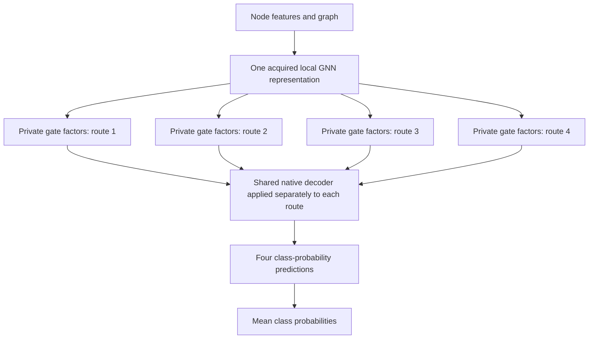

# GNNM: shared propagation in graph ensembles

GNNM learns several graph predictors with shared graph-layer weights. Small, trainable BatchEnsemble factors change each member's input and output projectors. Members keep separate hidden states throughout message passing, train on the mean member loss, and average their raw class logits at inference.

Sharing reduces stored weights. Each member still performs its own graph propagation. Our research priority is prediction quality: accurate members whose different predictions improve the final ensemble.

```text
node features and graph edges
             |
  four member input projectors
             |
  four separate hidden-state paths
  using shared graph-layer weights
             |
  four member output projectors
             |
       average raw logits
```

BatchEnsemble is established prior work ([Wen et al., 2020](https://arxiv.org/abs/2002.06715)); [Kim, 2023](https://koasas.kaist.ac.kr/handle/10203/308201) previously placed its factors inside GNN layers. Original GNNM uses boundary projectors. The later internal-factor and conditional-message procedures below change that placement or the information supplied to members. Every reported original paper score remains unchanged.

## Research status — 12 October 2026

**The larger study is being prepared and remains disabled until the user approves its exact run manifest.** Original GNNM’s five paper datasets will not be rerun. Original GNNM, capable single models and genuine independent ensembles will be tested on compatible new datasets.

| Work | Current state | Meaning |
| --- | --- | --- |
| Physics private GRU memory | 13/30 fresh fit groups complete; full cohort still training | Wait for the whole comparison before interpreting results |
| PubMed private landmark memory | Complete: 36 fresh groups, 54 trajectories, 39 CAL endpoints | No improvement over its source; all combined criteria failed |
| Training refactor | Full-budget engine and source-bound node, PolyFormer and molecular connections; 66 allocation CPU checks passed | Engineering verification, not new predictive results |
| New data preparation | Cora, CiteSeer, PubMed, WikiCS, Amazon Computers/Photo, Coauthor CS/Physics prepared; zero new fits/scores | Complete split/provider custody; CAL/evaluation targets separated from fitting inputs |
| Large-study coverage | Method/source inventory audited; native/molecular manifests and link connection in preparation | Final counts, author replication and remaining migration gaps must be explicit before approval |

PubMed LM4 and its listed source-equivalent controls selected checkpoint 0 after 100 executed continuation updates. Its mean development accuracy was **90.8308%**, exactly the selected source score in each seed. The mean difference versus equipped I4 was +0.2280 points with one negative seed; calibrated NLL was worse. This preserves a failed procedure and motivates better prospective training diagnostics, without claiming a learned improvement.

The refactor records complete TRAIN/SELECT trajectories, sample-weighted molecular epoch losses, actual optimizer counts and checkpoint/RNG restoration. Two experiment slots per GPU are prepared for the allocation plus 18.77's two GPUs, with fixed assignments and global phase gates. Current preparation uses allocation only; 18.77 synchronization and live environment checks are pending.

The catalog has 273 canonical entries across 73 families, including controls, diagnostics and unfinished implementations. It is **not a count of runnable methods**. Source-only and blocked procedures add no executed experiments.

- [Current research state](https://github.com/ChervovNikita/diploma_yandex_graphs/blob/codex/postsubmission-research-20260930/experiments_iclr/postsubmission_20260930/RESEARCH_STATE.md)
- [Training pipeline and preparation status](https://github.com/ChervovNikita/diploma_yandex_graphs/blob/codex/postsubmission-research-20260930/experiments_iclr/postsubmission_20260930/training_pipeline_v2_20261012/README.md)
- [Complete PubMed outcome and checkpoint selections](https://github.com/ChervovNikita/diploma_yandex_graphs/blob/codex/postsubmission-research-20260930/experiments_iclr/postsubmission_20260930/pubmed_LM4_complete_interpretation_root_20261012_v1/REPORT.md)
- [Recurrent-memory protocol and source](https://github.com/ChervovNikita/diploma_yandex_graphs/blob/codex/postsubmission-research-20260930/experiments_iclr/postsubmission_20260930/native_meanSAGE_private_GRU_execution_source_20261011_v1/README.md)
- [Complete outcomes and their reference limits](https://github.com/ChervovNikita/diploma_yandex_graphs/blob/codex/postsubmission-research-20260930/experiments_iclr/postsubmission_20260930/complete_quality_gain_reference_confirmation_evidence_map_20261011_v1/REPORT.md)

### Current recurrent-memory architecture

One ordinary source GNN first learns a useful local representation. Its first layer is then frozen. Four routes read that common representation along four fixed, label-free graph traversals. They share the main GRU weights, while small private gate factors and biases can learn different decisions about retaining graph history. A shared residual readout adds the resulting memory to each route's representation; the native GNN decoder predicts separately for each route.



All four memory routes use the same slow GRU weights. Each traverses the complete graph component in both directions and resets its state at component boundaries. The candidate uses **one pretrained source GNN**. Additional source models are acquired only for the independent references.

The fixed comparison includes decoder-only continuation, ordinary and factorized single learners using all four traversals, private native-factor placement, and genuine ordinary/factorized independent ensembles. Each independent learner has its own optimizer, validation selection and four traversals. Member competence compares four private candidate routes with four independent body-average predictions. All runs and calibration endpoints must finish before development outcomes are released together.

Recurrent BatchEnsemble, gated graph models and graph memory have prior literature. [Closest primary comparisons and conditional follow-up controls](https://github.com/ChervovNikita/diploma_yandex_graphs/blob/codex/postsubmission-research-20260930/experiments_iclr/postsubmission_20260930/common_P1_private_memory_primary_comparison_20261011_v1/REPORT.md) describe those overlaps. A new methodological advantage remains unproven. A worthwhile prediction result must survive stronger references, mechanism controls and an unused confirmation pipeline before paper promotion.

### Current landmark-memory architecture

LM4 uses one freshly learned native PolyFormer source. Its raw representation immediately before the class head is frozen. Four groups of fixed, label-free graph landmarks use private learned address offsets to collect remote node evidence. Graph-distance biases condition this exchange. Shared attention maps read that memory back into the common representation, and a shared native class head produces four route predictions whose class probabilities are averaged.

S64 and FS64 equip single learners with all 64 landmarks and ordinary or factorized memory maps. Their I4 references contain four complete, independently selected equipped learners, each using its own fresh source ancestor. Competence compares four private LM4 routes with four independent bodies. All 36 fresh fit groups, 54 optimizer trajectories and 39 calibration endpoints must close before one complete development release. PubMed is an encountered graph; fresh roles do not establish unused confirmation. No quality or novelty advantage is claimed.

## Strongest complete quality evidence

Accuracy is in percent; differences are percentage points. Each row is one complete, matched comparison. Evaluation populations and training procedures differ between rows.

| Setting | Shared procedure | Accuracy | Genuine independent reference | Accuracy | Shared minus independent |
| --- | --- | ---: | --- | ---: | ---: |
| WikiCS, selected development, 3 optimizer seeds | Internal-factor SAGE F | 80.6219 | Internal-factor I4 | 80.0847 | +0.5372 |
| WikiCS, selected development, 3 optimizer seeds | Endpoint-conditioned SAGE E | 81.1971 | Equally equipped I4 | 80.8937 | +0.3034 |
| Penn94, official split 0 heldout nodes, 10 optimizer repeats | Internal-factor SAGE | 78.1535 | Internal-factor I4 | 75.2993 | +2.8542 |
| Physics, heldout nodes under 10 mask/optimizer protocols | Endpoint-conditioned SAGE E | 91.3264 | Equally equipped I4 | 92.7891 | -1.4628 |

**WikiCS:** F's gains are positive in all three seeds, including +0.7205 points over the matched joint untied control. Its descriptive 95% interval against I4 is [-0.2653, 1.3398], and its mean calibrated-NLL allowance fails. E's smaller gain over its own equipped I4 also has an interval including zero. These are encountered development results.

**Penn94:** the +2.8542-point gain is positive in all ten repeats, with paired 95% interval [2.5464, 3.1620]. Its members improve by 2.1602 points. Original boundary GNNM reaches **79.1334%**, and the LINKX task reference reaches **84.6852%**. Thus internal sharing improves its matched independent reference while the full predeclared improvement criterion fails. The ten repeats share one graph and one fixed evaluation population.

**Physics:** E improves unchanged sharing by 0.7861 points but loses to its capable independent reference. The source meanSAGE single reaches **93.0590%**. This complete confirmation closes that E recipe; favorable development numbers do not establish transfer.

Within these completed comparisons, E supplies the highest new shared score in its WikiCS setting, while original boundary GNNM remains the stronger GNNM procedure on Penn94. There is no confirmed universally best extension.

- [WikiCS internal-factor sharing comparison](https://github.com/ChervovNikita/diploma_yandex_graphs/blob/codex/postsubmission-research-20260930/experiments_iclr/postsubmission_20260930/SAGE_matched_joint_reference_77_closed_history_20261011_v1/REPORT.md)
- [WikiCS endpoint comparison](https://github.com/ChervovNikita/diploma_yandex_graphs/blob/codex/postsubmission-research-20260930/experiments_iclr/postsubmission_20260930/native_SAGE_endpoint_value_closed_interpretation_root_20261011_v1/REPORT.md)
- [Penn94 complete results, uncertainty and costs](https://github.com/ChervovNikita/diploma_yandex_graphs/blob/codex/postsubmission-research-20260930/experiments_iclr/postsubmission_20260930/native_SAGE_Penn94_complete_confirmation_summary_root_20261011_v1/REPORT.md)
- [Physics complete confirmation](https://github.com/ChervovNikita/diploma_yandex_graphs/blob/codex/postsubmission-research-20260930/experiments_iclr/postsubmission_20260930/native_SAGE_Physics_complete_confirmation_summary_root_20261011_v1/REPORT.md)

### Completed architectural tests and decisions

The earlier graph-tour scanner finished all 30 comparison groups and 48 training trajectories, including inherited references. Its candidate scored **93.0132%**, compared with **93.1100%** unchanged sharing and **93.2850%** an equipped independent ensemble on the same encountered Physics protocols. Weaker members and losses during averaging outweighed its extra correct alternatives. That exact recipe is closed.

[Complete scanner outcomes and errors](https://github.com/ChervovNikita/diploma_yandex_graphs/blob/codex/postsubmission-research-20260930/experiments_iclr/postsubmission_20260930/graph_walk_complete_family_history_synthesis_20261011_v1/REPORT.md) remain preserved. The current GRU changes state-dependent memory, training stages and private parameter allocation; it is a separate fixed hypothesis. Other completed failures, costs and decisions remain in the ledger. Known ingredients can support a useful method, but their combination alone supplies no novelty or accuracy claim.

## Original benchmark, paper and reproducibility

The original five-dataset benchmark remains central to the paper. Its models, scores and reported selection procedure are preserved. The [complete anonymous V5 source](https://github.com/ChervovNikita/diploma_yandex_graphs/blob/codex/postsubmission-research-20260930/experiments_iclr/postsubmission_20260930/complete_anonymous_quality_draft_20261011_v5/README.md) contains the original tables and the added matched/heldout studies. It is a working revision, uncompiled and unreviewed; pagination and a new acceptance recommendation remain unverified.

Original implementations are `models.py`, `run_base.py` and `run_common.py`. Environment files are `pyproject.toml`, `uv.lock` and `environment.yml`. The documented runtime uses Python 3.11, Torch 2.1.2 with CUDA 11.8, PyG 2.7 and DGL 2.4.

The original README remains available at an immutable commit, preserving all commands and detailed evidence instructions:

- [Repository contents and original usage](https://github.com/ChervovNikita/diploma_yandex_graphs/blob/5fc577ece84f5c894797c9099ce43e8772b283c8/README.md#repository-contents)
- [Original benchmark table commands](https://github.com/ChervovNikita/diploma_yandex_graphs/blob/5fc577ece84f5c894797c9099ce43e8772b283c8/README.md#recalculate-the-original-benchmark-tables)
- [Compact evidence verifiers](https://github.com/ChervovNikita/diploma_yandex_graphs/blob/5fc577ece84f5c894797c9099ce43e8772b283c8/README.md#verify-the-compact-extension-evidence)
- [Fresh experiment setup, preparation and preflight](https://github.com/ChervovNikita/diploma_yandex_graphs/blob/5fc577ece84f5c894797c9099ce43e8772b283c8/README.md#run-new-experiments)
- [Data and interpretation](https://github.com/ChervovNikita/diploma_yandex_graphs/blob/5fc577ece84f5c894797c9099ce43e8772b283c8/README.md#data-and-interpretation)

Research source, fixed protocols and compact evidence are versioned on `codex/postsubmission-research-20260930`. Full datasets, checkpoints and member predictions stay on authorized research servers. Git records source changes, complete scalar results, uncertainty, failures, costs and decisions. Historical original launch-time source/environment/data fingerprints are incomplete; the newer fixed studies bind their inputs and execution evidence explicitly.

Fresh independent Codex reviewers apply the requested paper-review guidance after substantial supported progress and a complete manuscript revision. They receive immutable anonymous manuscript/evidence with no requested verdict. A clear acceptance recommendation and the overall research goal remain unmet.
