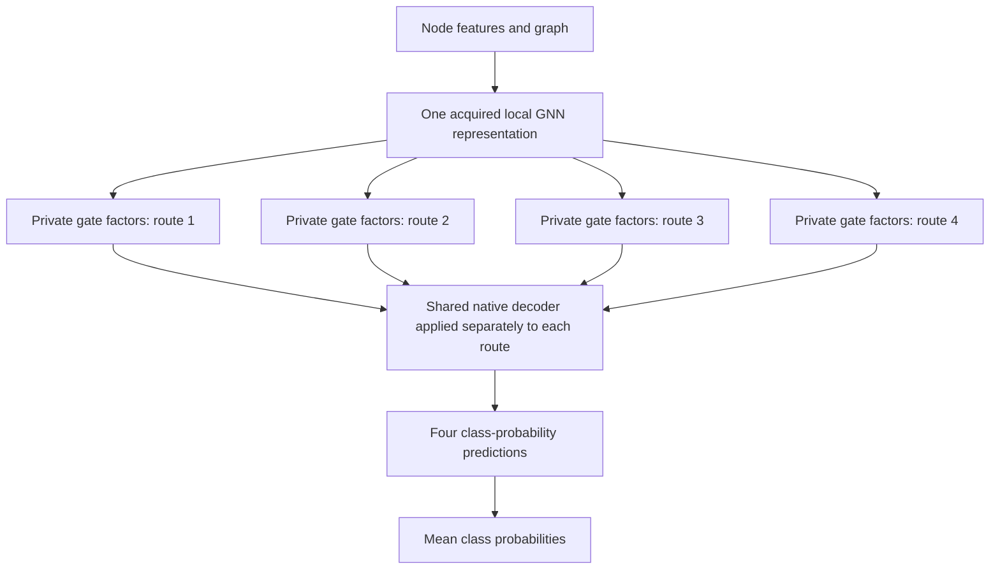

# GNNM: shared propagation in graph ensembles

## Comprehensive study preparation — 12 October 2026

The current **intermediate, disabled** roster contains **78,279 model-fit groups across 84 studies**, with 383,325,702–507,067,560 committed model optimizer calls registered as bounds. Native author CLI tracks are counted separately. These are planned costs; no new massive-study fit has started and no approval receipt exists.

The latest additions close the retained NCNC private versus pooled-completion methods, BUDDY shared-cache predictors, typed HGT and mixed objectives, FiLM, and Bayesian rank-one factors. Their native/source controls, genuine independent ensembles and explicit original-GNNM task adaptations are registered. Original GNNM paper scores are unchanged. Roman Empire, Amazon Ratings, Minesweeper, Questions and Tolokers are excluded for every method.

This is not the final proposal for approval. An exact source join found **27 further variants whose full training procedures still need ports or explicit mappings**. Those are being prepared; the final counts will change. Remaining resource work includes source-family memory/storage envelopes, two-slot concurrency admission, selected-checkpoint and replay lifetimes, and verification of 18.77 after the user restores access. Scheduling weights are not a runtime estimate.

The source-specific training protocols retain full-budget runs or native patience/caps as declared, save selected and terminal states separately, preserve failed attempts and charge paid stages. Large fits run alone when two cannot fit safely. A separate source-only replay proposal may remove duplicated model-free integer tapes; it is not adopted before full-source equivalence and RNG checks.

- [Exact intermediate method roster](experiments_iclr/postsubmission_20260930/human_master_v22_roster_root_20261012_v1/METHOD_ROSTER.csv)
- [Registered hyperparameters and source learning contracts](experiments_iclr/postsubmission_20260930/human_master_v22_roster_root_20261012_v1/EXACT_PROTOCOLS.json)
- [Study descriptions and immutable source references](experiments_iclr/postsubmission_20260930/human_master_v22_roster_root_20261012_v1/STUDIES.json)
- [Lossless reviewed source and metadata archive](experiments_iclr/postsubmission_20260930/publication/Expanded_native_ports_master_v22_20261012_v1/SOURCE_ARCHIVE_INDEX.json)

The existing Physics experiment continues under its original protocol. These preparation checks establish engineering behavior, not a new predictive advantage or methodological novelty.

## Research status — 12 October 2026

**The larger study is being prepared and remains disabled until the user approves its exact run manifest.** Original GNNM’s five paper datasets will not be rerun. Original GNNM, capable single models and genuine independent ensembles will be tested on compatible new datasets.

| Work | Current state | Meaning |
| --- | --- | --- |
| Physics private GRU memory | Last observed: 14/30 fresh fit groups complete; full cohort still training | Wait for the whole comparison before interpreting results |
| PubMed private landmark memory | Complete: 36 fresh groups, 54 trajectories, 39 CAL endpoints | No improvement over its source; all combined criteria failed |
| Training refactor | Full-budget engine; endpoint-conditioned and bootstrap procedures; original OGB author runner; frozen v8 manifest loads 95,856 job records | Engineering verification; no new predictive results |
| New study data | WikiCS, Amazon Photo, CiteSeer, PubMed, Coauthor CS/Physics, MolHIV, MolBACE and ogbl-collab in v8; zero new study fits/scores | Original GNNM included across all 34 standardized studies; original five excluded |
| Large-study coverage | Disabled v8: 38,309 planned model-fit groups plus 160 separate author trajectories | Remaining method ports, resource costs and final sync must close before approval |

PubMed LM4 and its listed source-equivalent controls selected checkpoint 0 after 100 executed continuation updates. Its mean development accuracy was **90.8308%**, exactly the selected source score in each seed. The mean difference versus equipped I4 was +0.2280 points with one negative seed; calibrated NLL was worse. This preserves a failed procedure and motivates better prospective training diagnostics, without claiming a learned improvement.

The refactor records complete TRAIN/SELECT trajectories, sample-weighted molecular epoch losses, actual optimizer counts and checkpoint/RNG restoration. Two experiment slots per GPU are prepared for the allocation plus 18.77's two GPUs, with fixed assignments and global phase gates. Current preparation uses allocation only; 18.77 synchronization and live environment checks are pending.

The catalog has 273 canonical entries across 73 families, including controls, diagnostics and unfinished implementations. It is **not a count of runnable methods**. Source-only and blocked procedures add no executed experiments.

The [v8 run roster](experiments_iclr/postsubmission_20260930/training_pipeline_v2_20261012/docs/INTEGRATED_RUN_ROSTER_20261012_V8.md) gives the current finite counts, budgets and GPU assignments. Eight new Coauthor memory checks passed; two Physics coupled-loss cases exceeded 32 and 60 GiB child limits. A source-preserving recomputation option passed six synthetic CPU checks and awaits actual-input memory qualification. No accuracy or novelty claim follows from these engineering checks.

- [Current research state](https://github.com/ChervovNikita/diploma_yandex_graphs/blob/codex/postsubmission-research-20260930/experiments_iclr/postsubmission_20260930/RESEARCH_STATE.md)
- [Training pipeline and preparation status](https://github.com/ChervovNikita/diploma_yandex_graphs/blob/codex/postsubmission-research-20260930/experiments_iclr/postsubmission_20260930/training_pipeline_v2_20261012/README.md)
- [Complete PubMed outcome and checkpoint selections](https://github.com/ChervovNikita/diploma_yandex_graphs/blob/codex/postsubmission-research-20260930/experiments_iclr/postsubmission_20260930/pubmed_LM4_complete_interpretation_root_20261012_v1/REPORT.md)
- [Recurrent-memory protocol and source](https://github.com/ChervovNikita/diploma_yandex_graphs/blob/codex/postsubmission-research-20260930/experiments_iclr/postsubmission_20260930/native_meanSAGE_private_GRU_execution_source_20261011_v1/README.md)
- [Complete outcomes and their reference limits](https://github.com/ChervovNikita/diploma_yandex_graphs/blob/codex/postsubmission-research-20260930/experiments_iclr/postsubmission_20260930/complete_quality_gain_reference_confirmation_evidence_map_20261011_v1/REPORT.md)

### Current recurrent-memory architecture

One ordinary source GNN first learns a useful local representation. Its first layer is then frozen. Four routes read that common representation along four fixed, label-free graph traversals. They share the main GRU weights, while small private gate factors and biases can learn different decisions about retaining graph history. A shared residual readout adds the resulting memory to each route's representation; the native GNN decoder predicts separately for each route.

All four memory routes use the same slow GRU weights. Each traverses the complete graph component in both directions and resets its state at component boundaries. The candidate uses **one pretrained source GNN**. Additional source models are acquired only for the independent references.

The fixed comparison includes decoder-only continuation, ordinary and factorized single learners using all four traversals, private native-factor placement, and genuine ordinary/factorized independent ensembles. Each independent learner has its own optimizer, validation selection and four traversals. Member competence compares four private candidate routes with four independent body-average predictions. All runs and calibration endpoints must finish before development outcomes are released together.

Recurrent BatchEnsemble, gated graph models and graph memory have prior literature. [Closest primary comparisons and conditional follow-up controls](https://github.com/ChervovNikita/diploma_yandex_graphs/blob/codex/postsubmission-research-20260930/experiments_iclr/postsubmission_20260930/common_P1_private_memory_primary_comparison_20261011_v1/REPORT.md) describe those overlaps. A new methodological advantage remains unproven. A worthwhile prediction result must survive stronger references, mechanism controls and an unused confirmation pipeline before paper promotion.

### Current landmark-memory architecture

LM4 uses one freshly learned native PolyFormer source. Its raw representation immediately before the class head is frozen. Four groups of fixed, label-free graph landmarks use private learned address offsets to collect remote node evidence. Graph-distance biases condition this exchange. Shared attention maps read that memory back into the common representation, and a shared native class head produces four route predictions whose class probabilities are averaged.

S64 and FS64 equip single learners with all 64 landmarks and ordinary or factorized memory maps. Their I4 references contain four complete, independently selected equipped learners, each using its own fresh source ancestor. Competence compares four private LM4 routes with four independent bodies. All 36 fresh fit groups, 54 optimizer trajectories and 39 calibration endpoints must close before one complete development release. PubMed is an encountered graph; fresh roles do not establish unused confirmation. No quality or novelty advantage is claimed.

## Strongest complete quality evidence

Accuracy is in percent; differences are percentage points. Each row is one complete, matched comparison. Evaluation populations and training procedures differ between rows.

| Setting | Shared procedure | Accuracy | Genuine independent reference | Accuracy | Shared minus independent |
| --- | --- | ---: | --- | ---: | ---: |
| WikiCS, selected development, 3 optimizer seeds | Internal-factor SAGE F | 80.6219 | Internal-factor I4 | 80.0847 | +0.5372 |
| WikiCS, selected development, 3 optimizer seeds | Endpoint-conditioned SAGE E | 81.1971 | Equally equipped I4 | 80.8937 | +0.3034 |
| Penn94, official split 0 heldout nodes, 10 optimizer repeats | Internal-factor SAGE | 78.1535 | Internal-factor I4 | 75.2993 | +2.8542 |
| Physics, heldout nodes under 10 mask/optimizer protocols | Endpoint-conditioned SAGE E | 91.3264 | Equally equipped I4 | 92.7891 | -1.4628 |

**WikiCS:** F's gains are positive in all three seeds, including +0.7205 points over the matched joint untied control. Its descriptive 95% interval against I4 is [-0.2653, 1.3398], and its mean calibrated-NLL allowance fails. E's smaller gain over its own equipped I4 also has an interval including zero. These are encountered development results.

**Penn94:** the +2.8542-point gain is positive in all ten repeats, with paired 95% interval [2.5464, 3.1620]. Its members improve by 2.1602 points. Original boundary GNNM reaches **79.1334%**, and the LINKX task reference reaches **84.6852%**. Thus internal sharing improves its matched independent reference while the full predeclared improvement criterion fails. The ten repeats share one graph and one fixed evaluation population.

**Physics:** E improves unchanged sharing by 0.7861 points but loses to its capable independent reference. The source meanSAGE single reaches **93.0590%**. This complete confirmation closes that E recipe; favorable development numbers do not establish transfer.

Within these completed comparisons, E supplies the highest new shared score in its WikiCS setting, while original boundary GNNM remains the stronger GNNM procedure on Penn94. There is no confirmed universally best extension.

- [WikiCS internal-factor sharing comparison](https://github.com/ChervovNikita/diploma_yandex_graphs/blob/codex/postsubmission-research-20260930/experiments_iclr/postsubmission_20260930/SAGE_matched_joint_reference_77_closed_history_20261011_v1/REPORT.md)
- [WikiCS endpoint comparison](https://github.com/ChervovNikita/diploma_yandex_graphs/blob/codex/postsubmission-research-20260930/experiments_iclr/postsubmission_20260930/native_SAGE_endpoint_value_closed_interpretation_root_20261011_v1/REPORT.md)
- [Penn94 complete results, uncertainty and costs](https://github.com/ChervovNikita/diploma_yandex_graphs/blob/codex/postsubmission-research-20260930/experiments_iclr/postsubmission_20260930/native_SAGE_Penn94_complete_confirmation_summary_root_20261011_v1/REPORT.md)
- [Physics complete confirmation](https://github.com/ChervovNikita/diploma_yandex_graphs/blob/codex/postsubmission-research-20260930/experiments_iclr/postsubmission_20260930/native_SAGE_Physics_complete_confirmation_summary_root_20261011_v1/REPORT.md)

### Completed architectural tests and decisions

The earlier graph-tour scanner finished all 30 comparison groups and 48 training trajectories, including inherited references. Its candidate scored **93.0132%**, compared with **93.1100%** unchanged sharing and **93.2850%** an equipped independent ensemble on the same encountered Physics protocols. Weaker members and losses during averaging outweighed its extra correct alternatives. That exact recipe is closed.

[Complete scanner outcomes and errors](https://github.com/ChervovNikita/diploma_yandex_graphs/blob/codex/postsubmission-research-20260930/experiments_iclr/postsubmission_20260930/graph_walk_complete_family_history_synthesis_20261011_v1/REPORT.md) remain preserved. The current GRU changes state-dependent memory, training stages and private parameter allocation; it is a separate fixed hypothesis. Other completed failures, costs and decisions remain in the ledger. Known ingredients can support a useful method, but their combination alone supplies no novelty or accuracy claim.

## Original benchmark, paper and reproducibility

The original five-dataset benchmark remains central to the paper. Its models, scores and reported selection procedure are preserved. The [complete anonymous V5 source](https://github.com/ChervovNikita/diploma_yandex_graphs/blob/codex/postsubmission-research-20260930/experiments_iclr/postsubmission_20260930/complete_anonymous_quality_draft_20261011_v5/README.md) contains the original tables and the added matched/heldout studies. It is a working revision, uncompiled and unreviewed; pagination and a new acceptance recommendation remain unverified.

Original implementations are `models.py`, `run_base.py` and `run_common.py`. Environment files are `pyproject.toml`, `uv.lock` and `environment.yml`. The documented runtime uses Python 3.11, Torch 2.1.2 with CUDA 11.8, PyG 2.7 and DGL 2.4.

The original README remains available at an immutable commit, preserving all commands and detailed evidence instructions:

- [Repository contents and original usage](https://github.com/ChervovNikita/diploma_yandex_graphs/blob/5fc577ece84f5c894797c9099ce43e8772b283c8/README.md#repository-contents)
- [Original benchmark table commands](https://github.com/ChervovNikita/diploma_yandex_graphs/blob/5fc577ece84f5c894797c9099ce43e8772b283c8/README.md#recalculate-the-original-benchmark-tables)
- [Compact evidence verifiers](https://github.com/ChervovNikita/diploma_yandex_graphs/blob/5fc577ece84f5c894797c9099ce43e8772b283c8/README.md#verify-the-compact-extension-evidence)
- [Fresh experiment setup, preparation and preflight](https://github.com/ChervovNikita/diploma_yandex_graphs/blob/5fc577ece84f5c894797c9099ce43e8772b283c8/README.md#run-new-experiments)
- [Data and interpretation](https://github.com/ChervovNikita/diploma_yandex_graphs/blob/5fc577ece84f5c894797c9099ce43e8772b283c8/README.md#data-and-interpretation)

Research source, fixed protocols and compact evidence are versioned on `codex/postsubmission-research-20260930`. Full datasets, checkpoints and member predictions stay on authorized research servers. Git records source changes, complete scalar results, uncertainty, failures, costs and decisions. Historical original launch-time source/environment/data fingerprints are incomplete; the newer fixed studies bind their inputs and execution evidence explicitly.

Fresh independent Codex reviewers apply the requested paper-review guidance after substantial supported progress and a complete manuscript revision. They receive immutable anonymous manuscript/evidence with no requested verdict. A clear acceptance recommendation and the overall research goal remain unmet.
